# N-Launcher — Lanceur de Jeux Console pour TI-Nspire CX II-T (Ndless)

**N-Launcher** (`N-Launcher.tns`) est un lanceur de jeux natif écrit en **C11 modulaire** pour les calculatrices **Texas Instruments TI-Nspire CX II-T** (ainsi que TI-Nspire CX / CX CAS) équipées de **Ndless**.

Il transforme la calculatrice en véritable interface de console portable (320×240 RGB565), accompagnée d'un **simulateur web interactif React/TypeScript** fidèle au pixel près pour tester et inspecter les binaires `.tns` sur ordinateur.

---

## Sommaire

- [Fonctionnalités principales](#fonctionnalités-principales)
- [Présentation des captures d'écran](#présentation-des-captures-décran)
  - [1. Grilles de jeux & Modes d'affichage](#1-grilles-de-jeux--modes-daffichage)
  - [2. Système multi-profils & Avatars](#2-système-multi-profils--avatars)
  - [3. Menu Paramètres & Rendu natif](#3-menu-paramètres--rendu-natif)
  - [4. Simulateur Web 320×240 & Guide matériel](#4-simulateur-web-320240--guide-matériel)
- [Installation sur TI-Nspire CX II-T](#installation-sur-ti-nspire-cx-ii-t)
- [Commandes sur la calculatrice](#commandes-sur-la-calculatrice)
- [Compilation & Simulateur Web](#compilation--simulateur-web)
- [Structure du dépôt](#structure-du-dépôt)

---

## Fonctionnalités principales

- **Détection intelligente des exécutables `.tns`** : inspecte les premiers octets (`PRG\0`, `Zehn`, `bFLT`) pour filtrer automatiquement les documents/cours TI-Nspire (`PK\x03\x04`, `*TIM`, XML) et les fichiers système.
- **Décodeur d'icônes `.ico` Windows complet** (`1` à `32 bpp`, PNG/AND, rognage alpha) avec repli élégant sur des tuiles monogrammes colorées.
- **5 dispositions de grille** (`1×1`, `2×2`, `3×2`, `3×3`, `4×3`, `4×4`) avec pagination fluide et affichage optionnel des noms et raccourcis.
- **3 modes d'affichage & 4 couleurs d'accent** (**12 thèmes**) : cycle **Sombre → Clair → Gris** (`DOC`) et **Bleu → Rouge → Vert → Jaune** (`MENU`) avec transition d'encre organique.
- **Système multi-profils isolés** : jusqu'à **8 profils** dotés chacun de ses favoris, raccourcis et statistiques de jeu, avec **43 avatars exclusifs**.
- **Recherche instantanée en bibliothèque** : tapez directement une lettre ou un chiffre pour filtrer dans la catégorie active (`TOUS`, `FAV`, `REC`).
- **Démarrage automatique sécurisé anti-boucle** : protection par garde `nl_boot_guard.cfg.tns` et mode récupération en maintenant `ESC` ou `ON` au démarrage.
- **Indicateur de batterie optique TI-OS** & **statistiques de temps de jeu** via l'horloge temps réel (RTC).

---

## Présentation des captures d'écran

### 1. Grilles de jeux & Modes d'affichage

| Grille `3×2` — Mode Sombre | Grille `3×2` — Mode Clair | Grille `3×2` — Avec noms des jeux |
| :---: | :---: | :---: |
| 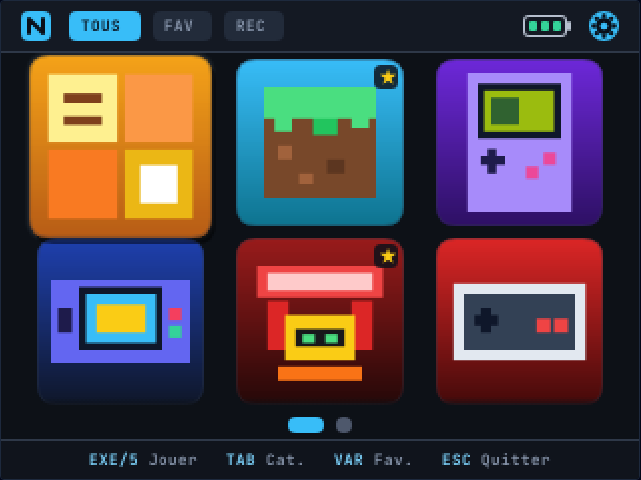 | 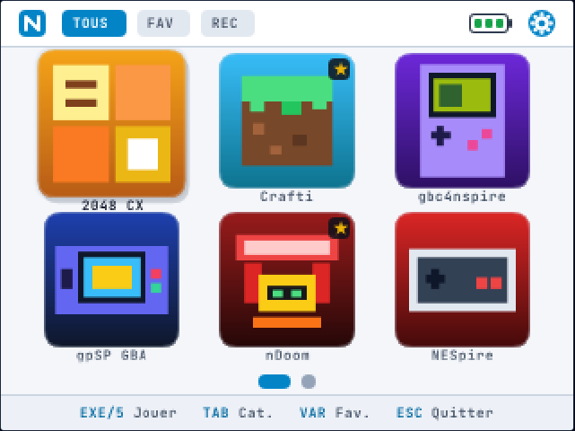 | 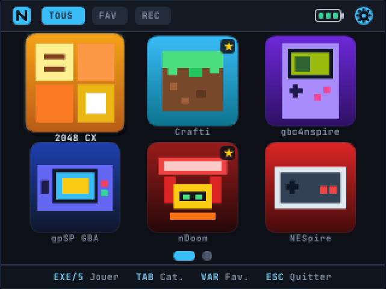 |

- **Grille `3×2` Mode Sombre (`01-grid-3x2-dark.png`)** : vue par défaut épurée mettant en avant les jaquettes `.ico` carrées, les badges favoris (`★`), l'indicateur de batterie en haut à droite, la capsule de catégorie active (`TOUS`, `FAV`, `REC`) et la barre d'aide en bas de l'écran.
- **Grille `3×2` Mode Clair (`02-grid-3x2-light.png`)** : bascule instantanée via la touche `DOC` vers le thème clair haute lisibilité (le Mode Gris est également disponible dans le cycle).
- **Grille `3×2` avec noms affichés (`03-grid-3x2-with-names.png`)** : lorsque l'option *Afficher les noms* est activée dans les paramètres, le titre de chaque jeu apparaît sous sa jaquette.

| Grille `3×3` (9 jeux/page) | Grille `4×3` (12 jeux/page) | Grille `2×2` — Tuiles Monogrammes |
| :---: | :---: | :---: |
| 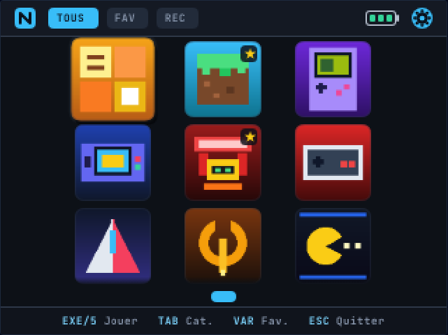 | 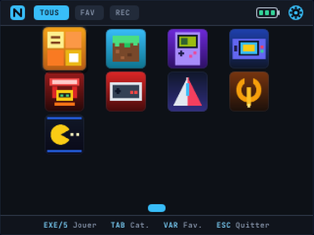 | 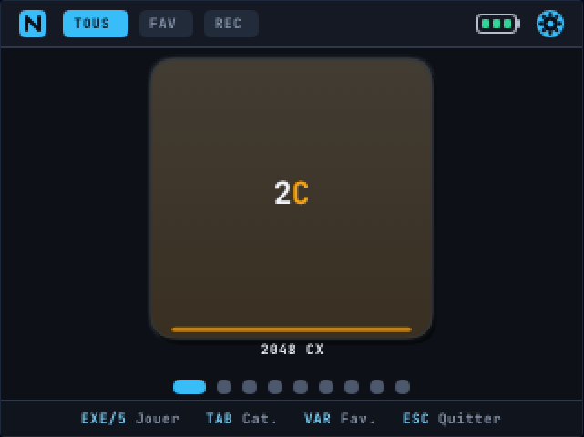 |

- **Grille `3×3` (`04-grid-3x3-dark.png`)** et **Grille `4×3` (`05-grid-4x3-dark.png`)** : vues haute densité permettant d'afficher respectivement jusqu'à 9 ou 12 jeux par page pour les grandes bibliothèques.
- **Grille `2×2` avec tuiles Monogrammes (`06-grid-2x2-monogram.png`)** : lorsqu'un jeu ne possède pas de jaquette `.ico` associée, N-Launcher génère automatiquement une carte monogramme colorée à partir de ses initiales.

---

### 2. Système multi-profils & Avatars

| Sélecteur rapide — Mode Sombre | Sélecteur rapide — Mode Clair |
| :---: | :---: |
| 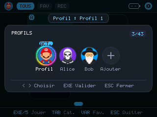 | 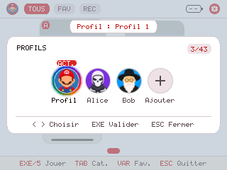 |

- **Sélecteur rapide de profil (`07-profiles-quick-modal-dark.png` & `08-profiles-quick-modal-light.png`)** : accessible directement depuis l'écran principal pour changer d'utilisateur en un instant (badge `ACT.` sur le profil actif, compteur d'avatars disponibles `3/43` et bouton `+ Ajouter`).

| Gestion des profils utilisateurs | Sélecteur d'avatar exclusif |
| :---: | :---: |
| 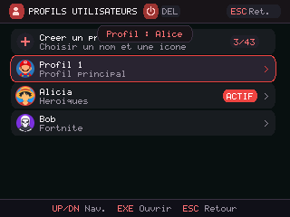 | 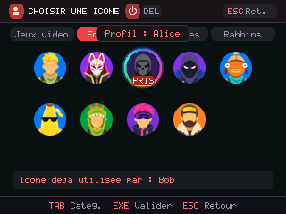 |

- **Gestion des profils (`09-profiles-settings.png`)** : menu dédié dans les paramètres (ici avec l'accentuation Rouge) pour créer, sélectionner ou supprimer un profil et isoler ses favoris, raccourcis et statistiques.
- **Sélecteur d'avatar (`10-profiles-avatar-picker.png`)** : galerie de **43 avatars** classés par catégories (*Jeux vidéo*, *Fortnite*, *Héroïques*, *Rabbins*...) avec détection en temps réel des icônes déjà attribuées à un autre profil (badge `PRIS`).

---

### 3. Menu Paramètres & Rendu natif

| Rendu natif C11 — Bibliothèque | Menu Paramètres (10 rubriques) |
| :---: | :---: |
| 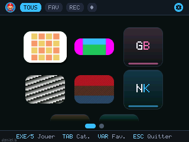 | 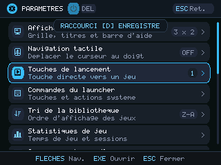 |

- **Rendu natif C11 (`14-native-frame-preview.png`)** : capture directe du framebuffer généré par le moteur C11 (`renderer.c`), incluant l'avatar du profil en haut à gauche et l'engrenage des paramètres en haut à droite.
- **Menu Paramètres (`15-native-settings-menu.png`)** : liste défilante à 10 rubriques (Affichage, Navigation tactile, Touches de lancement, Commandes, Tri, Statistiques de jeu, Profils, etc.) avec notification toast en haut d'écran (ici lors de l'enregistrement du raccourci `[D]`).

---

### 4. Simulateur Web 320×240 & Guide matériel

| Simulateur Web — Bibliothèque & Inspecteur | Simulateur Web — Exécution `nl_exec()` | Guide matériel — Touche `Save` |
| :---: | :---: | :---: |
| 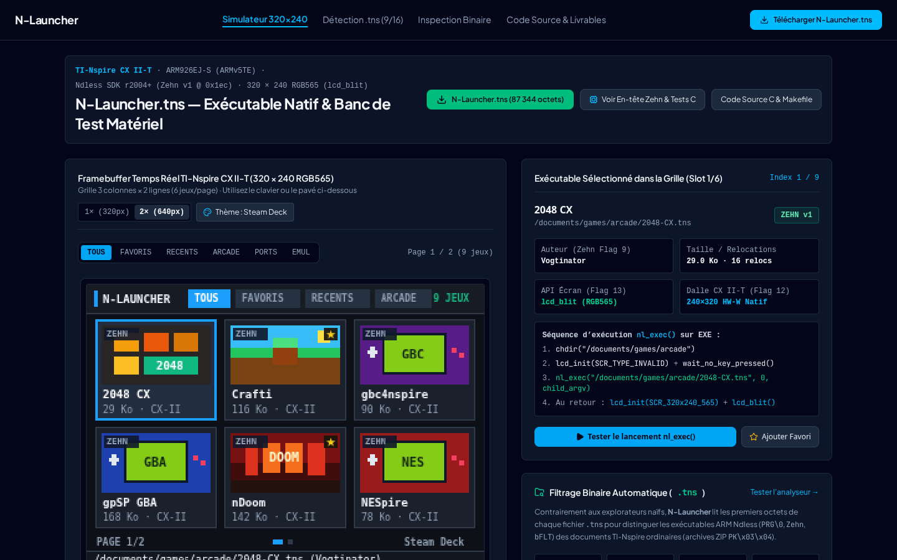 | 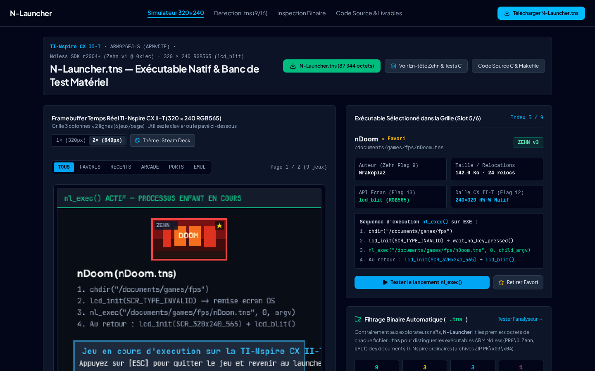 | 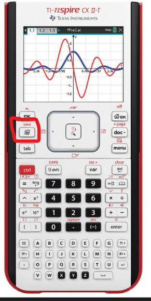 |

- **Simulateur Web (`11-web-simulator-library.png`)** : interface React/TypeScript reproduisant le framebuffer `320×240 RGB565` en temps réel, accompagnée d'un inspecteur d'en-tête Zehn (`auteur`, `taille`, `relocations`, `API écran`) et du journal de séquence `nl_exec()`.
- **Simulation `nl_exec()` (`12-web-simulator-nlexec.png`)** : visualisation étape par étape du basculement d'écran (`chdir`, `lcd_init(SCR_TYPE_INVALID)`, `nl_exec()`, puis restauration du launcher au retour du jeu).
- **Guide matériel (`13-calculator-save-button-guide.png`)** : repère visuel montrant la touche physique **`Save`** (à gauche du pavé tactile sur la TI-Nspire CX II-T) utilisée pour ouvrir et fermer rapidement le Menu Paramètres.

---

## Installation sur TI-Nspire CX II-T

1. Assurez-vous que **Ndless** est installé et actif sur votre calculatrice TI-Nspire CX II-T.
2. Téléchargez le binaire prêt à l'emploi [`releases/N-Launcher.tns`](releases/N-Launcher.tns) *(conservez exactement ce nom sans espace avant `.tns`)*.
3. Transférez **`N-Launcher.tns`** dans `/documents/ndless/` ou `/documents/` via TI-Nspire Computer Link / nLink.
4. Placez vos jeux `.tns` dans `/documents/games/`, `/documents/ndless/`, `/documents/roms/` ou n'importe quel sous-dossier de `/documents/`.
5. Lancez **`N-Launcher.tns`** depuis la calculatrice avec **`EXE`** (`Enter`).

> **Note :** En cas de problème avec le démarrage automatique, maintenez **`ESC`** ou **`ON`** pendant l'allumage de la calculatrice pour déclencher le mode récupération et revenir immédiatement sur TI-OS.

---

## Commandes sur la calculatrice

| Touche Physique TI-Nspire | Action dans N-Launcher |
| :--- | :--- |
| **Flèches** (ou `4`/`6`/`8`/`2`) | Naviguer dans la grille ou les paramètres |
| **Glissement sur le pavé tactile** *(si activé)* | Déplacer la sélection |
| **Clic central pavé tactile / `ENTER` / `5`** | Lancer le jeu sélectionné |
| **`Save` (`Ctrl+S`)** | Ouvrir / fermer le **Menu Paramètres** |
| **Lettres / chiffres (`A..Z`, `0..9`)** | Rechercher directement dans la bibliothèque (ou lancer via raccourci attribué) |
| **`TAB`** | Changer de catégorie (**`TOUS`** / **`FAV`** / **`REC`**) |
| **`DOC`** | Basculer le mode d'affichage (**Sombre → Clair → Gris**) |
| **`MENU`** | Changer la couleur d'accent (**Bleu → Rouge → Vert → Jaune**) |
| **`VAR` / `*` / `+`** | Ajouter ou retirer le jeu sélectionné des **Favoris (`★`)** |
| **`TRIG` (`7`) / `=` (`9`)** | Page précédente / Page suivante |
| **`DEL`** | Effacer en recherche, supprimer un raccourci ou actualiser le scan |
| **`ESC` / `ON`** | Fermer la recherche / revenir en arrière / quitter vers TI-OS |

---

## Compilation & Simulateur Web

### 1. Compiler le binaire natif (`native/`)
Nécessite le **Ndless SDK** (`nspire-gcc`, `nspire-ld`, `genzehn`, `make-prg`) et `gcc` pour la suite de tests hôte :

```bash
cd native
make clean all test
```

### 2. Lancer le simulateur Web (`src/`)
Nécessite **Node.js** (≥ 18) :

```bash
npm install
npm run dev
```

Le simulateur est ensuite accessible sur `http://localhost:3000`.

---

## Structure du dépôt

```text
n-launcher-ti-nspire/
├── releases/                 # Binaires compilés prêts à transférer (.tns)
│   ├── N-Launcher.tns        # Exécutable principal TI-Nspire CX II-T
│   └── nl_hotkey.tns         # Module résident expérimental de raccourci global (Ctrl+Menu)
├── native/                   # Code source C11 modulaire pour Ndless SDK
│   ├── main_ndless.c         # Boucle principale, matériel LCD & entrées
│   ├── scanner.c             # Détection et filtrage des exécutables .tns
│   ├── covers.c              # Décodeur .ico / PNG / BMP & lecture batterie optique
│   ├── profiles.c            # Gestion multi-profils & 43 avatars intégrés
│   ├── ui_state.c            # Machine à états de l'interface et paramètres
│   ├── animation.c           # Transitions fluides, encre organique & goutte liquide
│   ├── renderer.c            # Moteur de rendu RGB565 320×240
│   ├── storage.c             # Persistance atomique & démarrage automatique sécurisé
│   ├── test_runner.c         # Suite de tests unitaires C sur hôte
│   └── Makefile
├── src/                      # Simulateur Web React / TypeScript / Canvas 320×240
├── public/                   # Ressources statiques du simulateur web
└── docs/                     # Documentation technique & captures d'écran
    ├── screenshots/          # 15 captures présentées dans ce README
    ├── PROGRESS.md           # Suivi détaillé du développement
    └── TEST_REPORT.md        # Rapport de tests C & TypeScript
```

---

## English Summary & Technical Index

**N-Launcher** is a native **C11 console-style game launcher** (`N-Launcher.tns`) and **320×240 RGB565 React/TypeScript web simulator** for **Texas Instruments TI-Nspire CX II-T** (and TI-Nspire CX / CX CAS) calculators running **Ndless**.

- **Core features**: Binary `.tns` header scanner (`PRG\0`, `Zehn`, `bFLT`), Windows `.ico` / PNG / BMP cover decoder, 5 grid layouts (`1×1`–`4×4`), 12 themes (Dark / Light / Gray × 4 accents), 8 isolated user profiles with 43 avatars, instant library search, RTC play-time statistics, optical TI-OS battery indicator, and anti-bootloop autostart guard (`ESC`/`ON` recovery).
- **Technical reports & AI index**:
  - [Development Progress & Architecture Decisions](docs/PROGRESS.md)
  - [C & TypeScript Test Report](docs/TEST_REPORT.md)
  - [Structured AI / LLM Index (`llms.txt`)](llms.txt)

